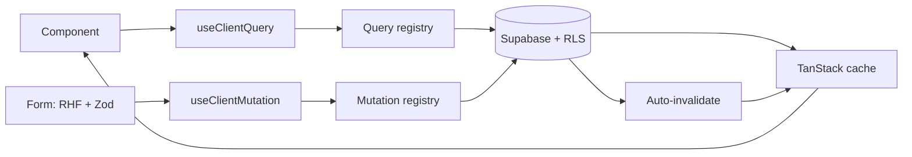

<p align="center">
  
</p>

<p align="center">
  <b>Delivery infrastructure for Bobi Labs.</b><br>
  The production scaffold and Claude Code workflow discipline behind every engagement.
</p>

<p align="center">
  <a href="https://bobistack.bobilabs.dev">bobistack.bobilabs.dev</a> &nbsp;&middot;&nbsp;
  <a href="https://bobilabs.dev/work">bobilabs.dev/work</a>
</p>

---

> **Proprietary and confidential.** Internal Bobi Labs infrastructure, not open source. See [LICENSE](LICENSE). May be opened up later once it has proven out further.

## What it is

bobi-stack is the codebase Bobi Labs starts every build from. Next.js, Supabase, and a typed data layer wired end to end, plus the Claude Code session and memory discipline that keeps AI-assisted delivery consistent across a multi-week engagement. It is a chunk of why a small senior team ships like a larger one.

Internally, a new engagement starts from this scaffold: copy it, point it at a fresh Supabase and Vercel project, fill the `CLAUDE.md` placeholders, and the data layer, conventions, and session discipline are already in place.

## Start here

Do these in order. Each step assumes the one above it is done.

1. **Install the toolchain.** [`docs/prerequisites.md`](docs/prerequisites.md) is the
   complete list: Node, pnpm, Git, Claude Code, and the `gh`, `vercel`, and `supabase`
   CLIs, plus the accounts and the traps. Do not skip to step 2 with a partial toolchain;
   most confusing setup failures are a missing CLI wearing a disguise.
2. **Stand the project up.** [`docs/starting-a-new-project.md`](docs/starting-a-new-project.md)
   for a new build, or [`docs/migrating-an-existing-project.md`](docs/migrating-an-existing-project.md)
   to bring an in-flight project onto these conventions. Both end with a working dev
   server, a linked Supabase and Vercel project, and generated database types.
3. **Fill in `CLAUDE.md`.** It is the session-start briefing every Claude Code session
   reads first. A scaffold with placeholder text in it produces sessions that guess.
4. **Open your first Claude Code session** with the kickoff prompt in
   [`docs/new-project-setup.md`](docs/new-project-setup.md). It tells the session what to
   read, in what order, before it writes anything.
5. **Only if you are running several coordinated repos:** set up the chat tree, below.
   One repo needs none of it.

## Architecture

Reads and writes flow through typed registries paired with hooks. Database types flow end to end: schema, generated types, SDK, query function, registry, hook, component. No hand-written types for DB data.



## What's in here

**Stack scaffolding.** Next.js 16 (App Router), React 19, TypeScript 5.7, Supabase, TanStack Query, Tailwind v4, shadcn/ui, Zod, Vercel, pnpm. The scaffold assumes the full stack; the workflow conventions are stack-agnostic.

**Workflow conventions:**

- `CLAUDE.md`: session-start checklist + project instructions pattern
- `.claude/memory-templates/`: memory file conventions (feedback, project, user, reference categories + a `MEMORY.md` index)
- `docs/calls/`: parsed call-notes convention (raw transcripts gitignored, parsed notes committed)
- `.screenshots/`: image-sharing convention for Claude sessions
- Principle files: fail-loudly, mutual-check-in, invoice-language, client-facing-quality
- `docs/recipes/`: situational patterns that are deliberately NOT default scaffold; adopt one when the project's shape calls for it

**Tooling:**

- `scripts/lib/drive.mjs` + `drive-cli.mjs`: Google Drive helpers (service account + env-based config)
- `scripts/pull-doc-images.mjs`: pull images from a Google Doc into `.screenshots/`
- `scripts/extract-docx-text.mjs`: quick text extraction from `.docx`
- `lib/tests/` + `/api/tests/run`: daily test-suite harness (synthetic end-to-end tests + health checks + email report)

**Claude skills** (invocable via `/<skill>` in Claude Code):

- `cli-first`: prefer CLI tools + env vars for third-party services
- `supabase-mutations`: write-path convention (Zod + registry + RHF)
- `supabase-query-system`: read-path convention (registry + TanStack)
- `new-query` / `new-mutation`: code generators
- `docs` / `bobi-stack` / `todo`: doc + project conventions
- `bosskey` / `lsp` / `squad`: orchestration helpers

## Project CLI

Everything goes through `ops.sh`:

```bash
./ops.sh dev          # Dev server
./ops.sh build        # Production build
./ops.sh check        # Lint + typecheck
./ops.sh test         # Run tests
./ops.sh deploy       # Deploy preview
./ops.sh deploy prod  # Deploy production
./ops.sh gen-types    # Regenerate Supabase DB types
./ops.sh help         # See all commands
```

## Conventions

- **Push back honestly.** If Claude (or you) sees a better path, say it. A solid product beats being agreeable. See `.claude/memory-templates/feedback_mutual_check_in.md`.
- **Fail loudly in client-facing steps.** Silent failures erode trust fastest. Every user-triggered action that can fail must surface a plain-English reason and a path forward. See `.claude/memory-templates/feedback_error_handling.md`.
- **One commit per logical change.** No while-I-am-at-it bundling.
- **Memory files are lessons learned, not summaries.** The memory folder captures what was hard-won. `CLAUDE.md` captures current project state.
- **Start fresh chats for new batches of work.** Long chats degrade. Memory carries forward what matters; chat context does not need to.

## Scaling up: many repos, many sessions

A single repo needs none of this section. But when one operator runs **multiple coordinated repos through multiple Claude sessions**, the scaffold has a proven answer: the **chat tree** ([`docs/recipes/multi-session-orchestration.md`](docs/recipes/multi-session-orchestration.md)).

The short version: one repo becomes the **keeper**, holding append-only comms logs (one per participating repo), a curated decisions changelog, and the tree's constitution. Every other repo is a **box** with exactly one session. Boxes never talk to each other; they file entries in their own log, and the keeper arbitrates, rules, and writes decisions down. The git-tracked logs are the channel, so the system survives context resets, machine changes, and weeks of idle time.

Why bother: pointed single-purpose chats exhaust context windows far slower and stay more accurate than one sprawling chat, a written chain of command means no session overwrites another's work, and no decision has to be re-explained. The operator stops being the courier between chats.

Four pieces that turned out to matter more than expected, each learned by being burned:

- **A confidentiality wall between client work and product work.** Client specifics drifting upward into shared scaffolding is the failure that started all of this. Lessons cross the wall only after the keeper strips them to mechanism.
- **A `Waiting on Bees:` line ending every log entry.** The operator-action extract, imperative and capped at three items, or the word "nothing". Boxes write thorough conclusions; humans need the asks in one line. The keeper aggregates them into a single "who needs what" on demand.
- **Seams for the daily case.** When one box writes every day under conventions another box owns, routing each question through the keeper is pure latency. A seam is a keeper-opened file with a strict subject boundary where two boxes talk directly. Conventions, never cases.
- **Boxes outlive their chats.** A box is a directory plus a log, not a conversation. Close a chat, open a new one against the same log, and the work continues. Work orders go to a box's open session; they do not require a fresh chat.

When to adopt: the first time two repos need to agree on something (shared database, shared brand rules, one product embedding another). Copy-paste starter files live in [`docs/recipes/umbrella-starter/`](docs/recipes/umbrella-starter/); adopt them via the recipe's "Adopting it" steps, not by copying the folder wholesale. Until then, ignore it: the overhead is real, and single-repo projects should skip it on purpose.

## Internal docs

- [`docs/starting-a-new-project.md`](docs/starting-a-new-project.md): standing up a new engagement from the scaffold
- [`docs/migrating-an-existing-project.md`](docs/migrating-an-existing-project.md): bringing an in-flight project onto these conventions
- [`CONTRIBUTING.md`](CONTRIBUTING.md): how the scaffold itself evolves
- [`CHANGELOG.md`](CHANGELOG.md): what changed and why

## License

Proprietary. Copyright (c) 2026 Bobi Labs. All rights reserved. See [LICENSE](LICENSE).
