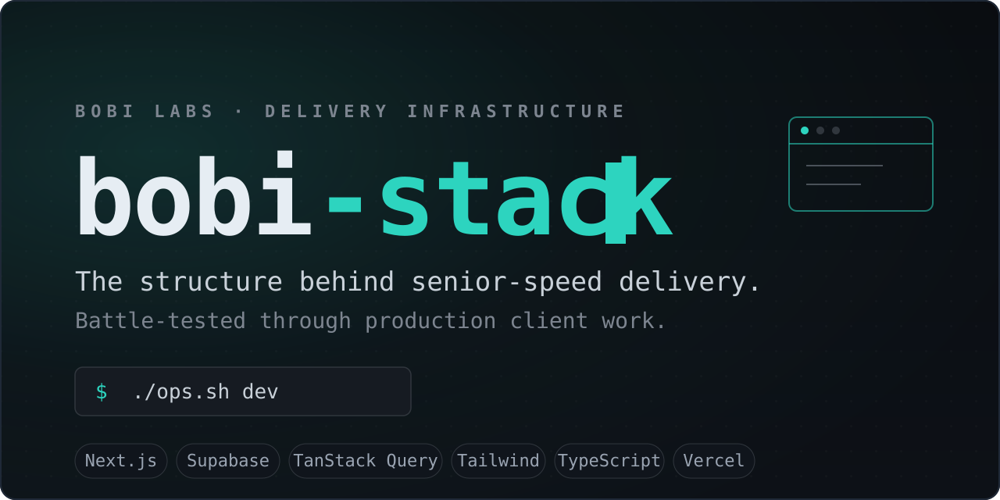
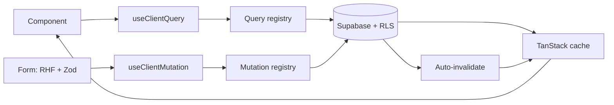

<p align="center">
  
</p>

<p align="center">
  <a href="https://github.com/Bobi-Labs/bobi-stack/actions/workflows/ci.yml"></a>
  <a href="LICENSE"></a>
  <a href="https://github.com/Bobi-Labs/bobi-stack/generate"></a>
  
</p>

<p align="center">
  <b>Next.js + Supabase + TanStack Query starter kit with a Claude Code workflow baked in.</b><br>
  Battle-tested through production client work.
</p>

<p align="center">
  <a href="https://bobistack.bobilabs.dev">Website</a> &nbsp;&middot;&nbsp;
  <a href="docs/starting-a-new-project.md">Start a project</a> &nbsp;&middot;&nbsp;
  <a href="docs/migrating-an-existing-project.md">Migrate a project</a> &nbsp;&middot;&nbsp;
  <a href="CONTRIBUTING.md">Contributing</a>
</p>

---

## What it is

bobi-stack is a clone-and-fill scaffold. You copy it, strip its git history, fill in the placeholders, and grow a project from it. The stack (Next.js 14, Supabase, TanStack Query, Tailwind, shadcn/ui, Vercel, pnpm) comes pre-wired, and the Claude Code workflow conventions ship with it so AI-assisted sessions stay consistent across chats.

Two ways in:

- **Start a new project.** See [`docs/starting-a-new-project.md`](docs/starting-a-new-project.md). Clone, rename, fill the `CLAUDE.md` placeholders, set up Supabase + Vercel, ship.
- **Bring an existing project up to these conventions.** See [`docs/migrating-an-existing-project.md`](docs/migrating-an-existing-project.md). Open it in Claude Code, paste the migration prompt, approve what fits, skip what does not.

## Architecture

Reads and writes flow through typed registries paired with hooks. Database types flow end to end: schema, generated types, SDK, query function, registry, hook, component. No hand-written types for DB data.



## Quick start

```bash
# Clone, then drop the template's history
git clone https://github.com/Bobi-Labs/bobi-stack.git my-project
cd my-project && rm -rf .git && git init -b main

# Environment
cp .env.example .env.local    # fill in Supabase credentials
./ops.sh install              # pnpm install
./ops.sh dev                  # localhost:3000

# First session with Claude Code
#  1. fill in CLAUDE.md placeholders (name, overview, stack, domain notes)
#  2. copy .claude/memory-templates/ into your Claude memory folder at
#     ~/.claude/projects/<project-dir>/memory/
#  3. run /bobi-stack to auto-fill CLAUDE.md from the real codebase
#  4. read docs/starting-a-new-project.md for the full walkthrough
```

Prefer the green **Use this template** button at the top of the repo to skip the history-stripping step entirely.

## What's in here

**Stack scaffolding.** Next.js 14, Supabase, TanStack Query, Tailwind, shadcn/ui, Vercel, pnpm. Opt in as needed. The scaffold assumes the full stack; the workflow conventions are stack-agnostic.

**Workflow conventions** (stack-agnostic, always useful):

- `CLAUDE.md`: session-start checklist + project instructions pattern
- `.claude/memory-templates/`: memory file conventions (feedback, project, user, reference categories + a `MEMORY.md` index)
- `docs/calls/`: parsed call-notes convention (raw transcripts gitignored, parsed notes committed)
- `.screenshots/`: image-sharing convention for Claude sessions
- Principle files: fail-loudly, mutual-check-in, invoice-language, client-facing-quality, all generic, all battle-tested

**Tooling** (opt-in, only if the project needs it):

- `scripts/lib/drive.mjs` + `drive-cli.mjs`: Google Drive helpers (service account + env-based config)
- `scripts/pull-doc-images.mjs`: pull images from a Google Doc into `.screenshots/` so Claude reads them without chat bloat
- `scripts/extract-docx-text.mjs`: quick text extraction from `.docx`
- `lib/tests/` + `/api/tests/run`: daily test-suite harness (synthetic end-to-end tests + health checks + email report)

**Claude skills** (invocable via `/<skill>` in Claude Code):

- `cli-first`: prefer CLI tools + env vars for third-party services
- `supabase-mutations`: write-path convention (Zod + registry + RHF)
- `supabase-query-system`: read-path convention (registry + TanStack)
- `new-query` / `new-mutation`: code generators
- `docs` / `bobi-stack` / `todo`: doc + project conventions
- `bosskey` / `lsp` / `squad`: orchestration helpers

## Project CLI

Everything goes through `ops.sh`:

```bash
./ops.sh dev          # Dev server
./ops.sh build        # Production build
./ops.sh check        # Lint + typecheck
./ops.sh test         # Run tests
./ops.sh deploy       # Deploy preview
./ops.sh deploy prod  # Deploy production
./ops.sh gen-types    # Regenerate Supabase DB types
./ops.sh help         # See all commands
```

## Conventions

- **Push back honestly.** If Claude (or you) sees a better path, say it. A solid product beats being agreeable. See `.claude/memory-templates/feedback_mutual_check_in.md`.
- **Fail loudly in client-facing steps.** Silent failures erode trust fastest. Every user-triggered action that can fail must surface a plain-English reason and a path forward. See `.claude/memory-templates/feedback_error_handling.md`.
- **One commit per logical change.** No while-I-am-at-it bundling.
- **Memory files are lessons learned, not summaries.** The memory folder captures what was hard-won. `CLAUDE.md` captures current project state. Different purposes.
- **Start fresh chats for new batches of work.** Long chats degrade. Memory carries forward what matters; chat context does not need to.

## Versioning

This template evolves. Each substantial pattern addition bumps the minor version. Projects on v1.x can pull later patterns in via the migration prompt. Current: **v2.0** (2026-04).

## License

MIT. See [LICENSE](LICENSE).
